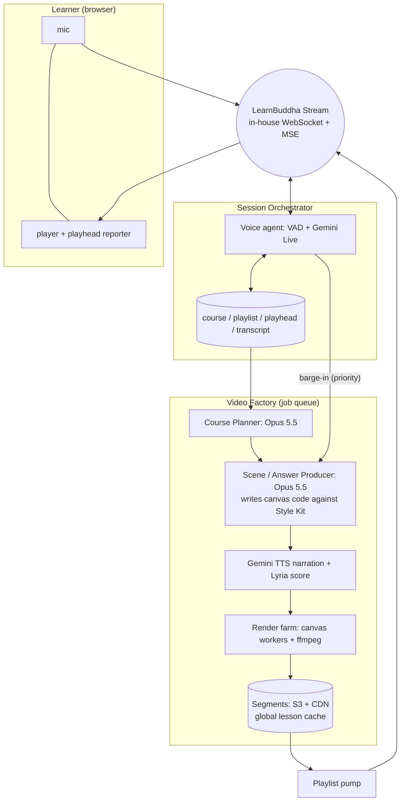

# LearnBuddha
**A patient, real-time video tutor — ask anything, mid-lesson.**
*Product & technical writeup · v0.2 · Nov 2026*

---

## 1. What LearnBuddha is

LearnBuddha is an AI tutor that teaches like a great private teacher with a whiteboard. You say what you
want to learn; it **builds a course, then teaches it as a narrated motion-graphics film** — drawn,
animated, voiced and scored entirely by code. At any moment you can interrupt with a question, just like
with a human tutor. LearnBuddha pauses, answers — first in conversation, then as a short visual
explanation **in the exact same visual style** — and smoothly resumes the lesson from where it stopped.

The brand promise is in the name: **calm, patient, ego-less**. No question is dumb, nothing is rushed.
The default visual language, *"Zen Board"* — warm paper, ink strokes, one vermilion accent, gentle
motion, a quiet ambient score — makes the product feel like a study, not a dashboard.

**Why now:** long-horizon coding agents (Claude Opus 5.5), real-time voice models (Gemini Live), and
cheap CPU rendering make code-generated film tutoring practical. And because our video is
**deterministic code, not diffusion pixels**, we can pause anywhere, re-render the exact frame on
screen, and grow an answer out of it — something no generated-video competitor can do.

**We own the whole visual stack:** our own style library, our own canvas + ffmpeg rendering pipeline,
and our own streaming layer. No third-party video SDKs, no style-library license strings.

---

## 2. The experience, end to end

1. **Ask.** "Teach me why sample variance divides by n−1. I know basic algebra."
2. **Plan.** Within seconds, an outline appears: 3 lessons, 9 scenes, ~8 minutes, two checkpoints.
3. **Watch.** The first scene starts within ~2–3 minutes; the rest render silently ahead of the
   playhead. Narration, captions and animation are word-synced.
4. **Interrupt.** "Wait — why does using the sample mean shrink the spread?" The video pauses
   instantly; a warm voice answers in about a second.
5. **See the answer.** About a minute later, a 20–30s visual answer plays — starting from *the very
   frame you paused on*, same ink, same hand.
6. **Resume.** A 4-second recap card, then the lesson continues from the start of the interrupted
   sentence. Your place is never lost.

---

## 3. Functionality in detail

### 3.1 Course planner
- Takes topic + goal + available time; asks at most 2–3 diagnostic questions (level, prerequisites).
- Produces a structured course: modules → lessons → scenes, each with a learning objective, key
  points, target duration and a checkpoint question.
- **Grounded content:** the planner researches via search/RAG; every script claim is fact-checked
  before rendering, and sources are stored with the scene metadata.
- The outline is editable: reorder, drop, or request "gentler" / "deeper" — the plan re-flows and only
  affected scenes re-render.

### 3.2 Lesson player
- Word-synced captions (from narration timestamps), chapter rail, transcript panel.
- Playback speed 0.75–1.5×, 10-second rewind, pause/play, "explain again" (regenerates the current
  scene at a simpler level, same style).
- Two ways to ask: **always-on voice** (barge-in) or typed questions; push-to-talk as a fallback.
- End of course: downloadable notes, a summary card, and the full Q&A log.

### 3.3 Checkpoints and adaptation
- Each lesson ends with 1–2 quick questions (spoken or tapped answers).
- Wrong answer → a short remediation scene in the same style, targeting the specific misconception;
  correct → continue. Mastery is tracked per objective and shapes later lessons.

### 3.4 Memory and review
- Every session keeps a transcript, Q&A log and mastery map; courses resume across devices.
- Repeated questions on the same concept become review cards; spaced revisit prompts are offered at
  the end of a course.

### 3.5 Accessibility
- Captions on by default, full keyboard control, a high-contrast Style Kit variant, and an audio-only
  mode (narration + transcript) for low-bandwidth use.

---

## 4. Real-time Q&A: barge-in, answers, resume

The playlist is a list we can splice:

```text
Before:  [S1][S2][S3][S4 ─────────────────][S5]…
                          ▲ "why n−1?" @ 00:42
After:   [S1][S2][S3][S4a 0:00–0:42][ANSWER 0:25][RECAP 0:04][S4b 0:39–end][S5]…
```

- **~0.2s:** voice-activity detection pauses the video, saves the playhead, ducks the music.
- **~1s:** Gemini Live — injected with the scene's script, transcript and what is on screen — begins
  speaking the answer.
- **In parallel:** the Answer Producer (same Style Kit, same golden scenes) generates a short visual
  answer. Because rendering is deterministic, the clip **opens on a re-render of the exact paused
  frame**, then annotates it — the answer visibly grows out of the lesson.
- **Interrupt classification:** *question* → full flow; *control* ("slower", "repeat", "skip") → adjust
  without a new video; *noise/cough* → resume immediately.
- **Resume:** snap back to the start of the interrupted sentence (word timestamps), play a 4s recap
  card, continue. Interruptions during answers work the same way, recursively.
- **Budgets:** visual answers capped at ~45s; trivial questions get voice-only answers; browser echo
  cancellation prevents the tutor's own voice from triggering barge-in.

| Moment | Target |
|---|---|
| Speech → pause | ~0.2 s |
| Speech → spoken answer | ~1 s |
| Speech → visual answer | 40–90 s (voice covers the gap) |
| Topic → first scene | 2–3 min (outline in ~15 s) |
| Buffer starvation | <1% of session time (styled quiz interstitials as fallback) |

---

## 5. System architecture

Two lanes: a **fast conversation lane** (milliseconds) and a **slow video factory** (seconds–minutes),
joined by a session state machine that owns the playlist and playhead.



| Component | Choice | Role |
|---|---|---|
| Brain / code writer | Claude Opus 5.5 | Plans courses, writes narration + animation code, QA |
| Visuals | **DIY canvas + ffmpeg (ours)** | Deterministic 2D/WebGL scenes rendered frame-by-frame |
| Illustration assets | claude-drawing-skill (MIT) | Ink-style stills and draw-on reveals matching Zen Board |
| Narration / music / live voice | Gemini TTS · Lyria · Gemini Live | Word-synced narration, ducked score, instant spoken answers |
| Streaming | **In-house: WebSocket + MSE** | Media downstream, mic upstream, control messages |
| Orchestration / state | FastAPI + Redis/Celery · Postgres · S3/CDN | State machine, priority queues, cache |
| Client | React + Media Source Extensions | Playback, captions, mic capture, playhead reporting |

---

## 6. Our own style library (the "Style Kit")

Built once, frozen per course, reused for **every** scene and **every** answer:

- **Design tokens** — one JSON: paper-and-ink palette, two fonts, spacing grid, easing curves, stroke
  widths, narrator voice ID, Lyria music prompt.
- **Component library** — ~18 canvas primitives: `TitleCard`, `BulletReveal`, `EquationWrite`,
  `Underline`, `CircleHighlight`, `Arrow`, `AxesPlot`, `ZoomPan`, `SideBySide`, `RecapCard`, progress
  bar… One idea per shot; ≤8 words per label. Math is typeset (KaTeX → SVG → canvas paths) so
  equations can be written stroke-by-stroke.
- **Golden scenes** — 2–3 hand-approved reference scenes shipped as few-shot examples in every
  generation prompt. This is what keeps scene 40 looking like scene 1.
- **`SKILL.md`** — one page of shot grammar, pacing rules and a QA checklist (overflow, contrast,
  sync drift).
- **Freeze rule** — the kit is versioned (`zen-board-v1`); answers inherit it by construction, so
  "same style" is guaranteed, not hoped for.

---

## 7. Our own video pipeline (DIY canvas + ffmpeg)

**Scene format:** every scene is a TypeScript module exporting a duration and a pure
`render(ctx, t)` function — a deterministic drawing of the scene at time *t*, with a fixed seed and
preloaded assets. No side effects, no wall-clock reads. This one decision gives us:

- **Perfect parallelism** — any frame renders independently, so frames split across workers.
- **The freeze-frame trick** — re-rendering the exact paused frame takes seconds.
- **One codebase, two uses** — the same module runs in the browser for previews and in workers for
  final renders.

**Per scene, narration first** — visuals are timed to the voice, never the reverse:

1. **Script** — Opus writes the scene script from the course plan (grounded, fact-checked).
2. **Narrate** — Gemini TTS renders audio; word timestamps from TTS metadata or forced alignment.
3. **Animate** — Opus writes the scene module against the Style Kit, with word timings as constants
   ("circle `n−1` at 12.4s, on the word *correction*").
4. **Render** — headless-browser canvas workers seek to each *t*, read pixels, and pipe raw frames to
   ffmpeg (H.264/AAC, uniform encode profile). 720p draft for answers, 1080p for lessons.
5. **Mix** — ffmpeg lays narration over a Lyria bed, ducked under speech using the word timings;
   loudness-normalized.
6. **QA** — Opus reviews sampled frames against the checklist; max one fix round.
7. **Publish** — `scene.mp4` + `scene.json` (transcript, timings, seed, code path) to the store.

**Economics:** lessons are cached **globally** by `topic + level + style + language` — "intro to
derivatives, Zen Board, English" renders once for all users forever. Only Q&A clips are bespoke. The
content library compounds into an asset competitors must re-render.

---

## 8. Our own streaming layer (in-house, no RTC SDK)

One viewer per session means we don't need an SFU — a single WebSocket carries everything:

- **Downstream (video):** a server-side *playlist pump* pushes fMP4/CMAF chunks of the current
  playlist over the socket, ~10–20s ahead of the client buffer. The client appends them to a Media
  Source Extensions `SourceBuffer`; all segments share one encode profile so they concatenate
  seamlessly, with timestamp offsets handled at splice points.
- **Upstream (voice):** the mic is captured via an AudioWorklet, encoded (Opus/PCM), and streamed on
  the same socket to server-side VAD → Gemini Live. Echo cancellation is enabled at capture.
- **Control channel:** small JSON messages both ways — `playhead` (every ~500ms), `barge_in`,
  `pause`, `splice`, `answer_ready`, `resume`, `caption`.
- **Pause/splice mechanics:** pause = stop pumping + `video.pause()`; an answer = orchestrator
  rewrites the playlist, pump switches to the new segments at the next chunk boundary; resume =
  seek to the saved sentence start and continue.
- **Scale path:** segments are plain static files, so the same library serves CDN/HLS clients later
  without touching the factory.

---


**In one line:** LearnBuddha is a TV station with a talkback channel — a factory rendering short,
style-locked films ahead of a playhead, and an always-listening voice that buys the factory the minute
it needs. The lesson never loses your place; the tutor never loses patience.